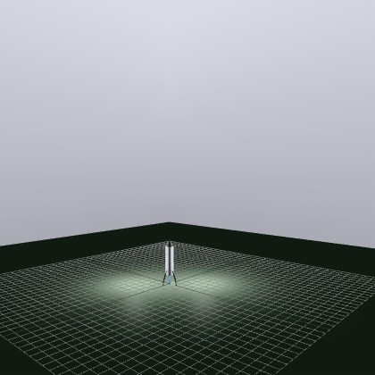

# Rocket Hopper Simulator

Python 6-DOF simulator for developing a thrust-vector-controlled (TVC) rocket-hopper flight controller.
The simulation runs on [Drake](https://drake.mit.edu/) (`pydrake`); the controller and estimator are
plain Python that never import it.



*`configs/scenarios/hop_nominal.yaml`: climb to 10 m, hover, translate 3 m and land.*

## Layout

uv workspace. The flight software is split into standalone packages under `packages/`; the root
`hopper` package is the simulator and the only place they are composed.

| Package                      | Import              | Role                                           |
| ---------------------------- | ------------------- | ---------------------------------------------- |
| `packages/hopper-core`       | `hopper_core`       | shared `types` and `math3d`                    |
| `packages/hopper-control`    | `hopper_control`    | attitude/position/mission controller           |
| `packages/hopper-estimation` | `hopper_estimation` | EKF and propellant estimator                   |
| root                         | `hopper`            | Drake simulation, sensors, scenarios, analysis |

## Install

This project uses [mise](https://mise.jdx.dev/). If you don't want to (or can't) install mise, the python side of things can be controlled via [uv](https://docs.astral.sh/uv).

## Run

```sh
uv sync
uv run scripts/run_scenario.py configs/scenarios/hop_nominal.yaml [--meshcat (for visualisation)]
```

## Development

The project is built step by step. Start with [docs/AGENT_START.md](docs/AGENT_START.md);
conventions are in [docs/CONVENTIONS.md](docs/CONVENTIONS.md) and status in [docs/PROGRESS.md](docs/PROGRESS.md).
